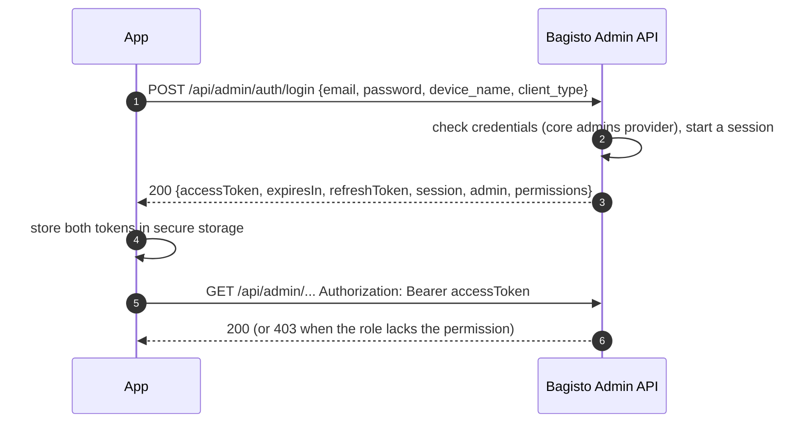
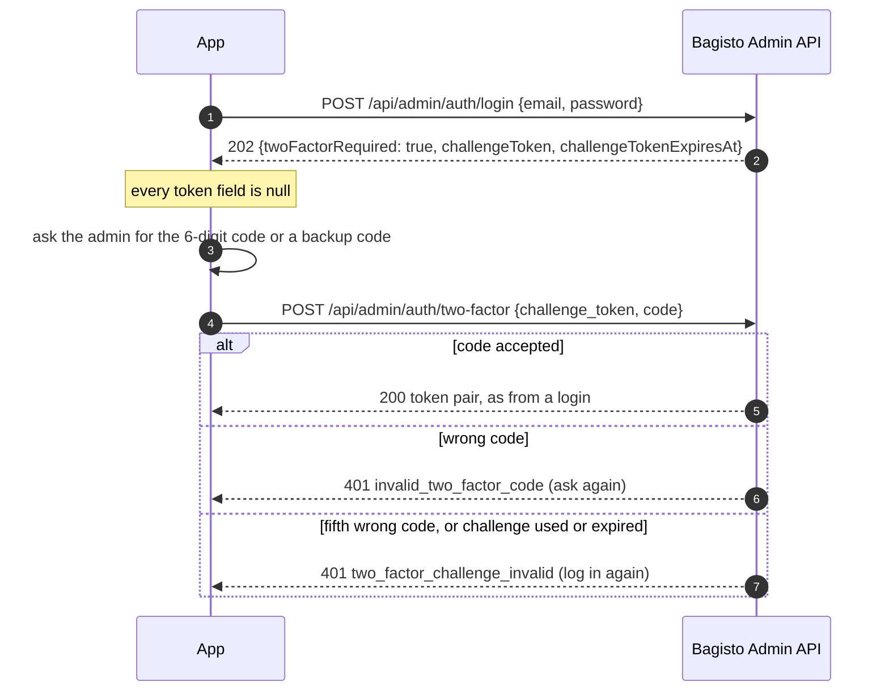
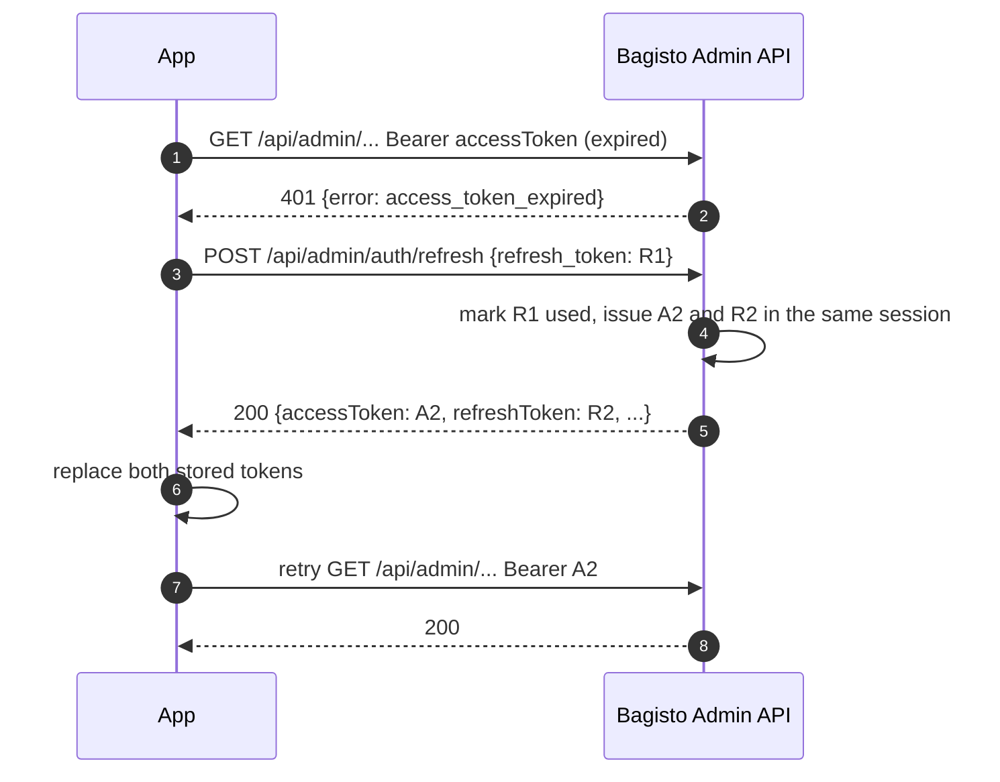
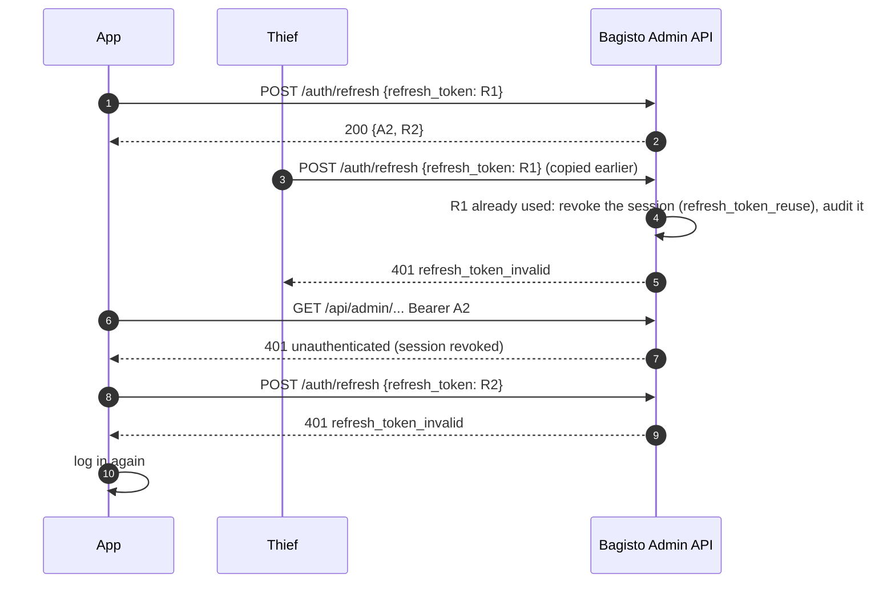

# Authentication

This guide explains how a client authenticates against both surfaces of the Bagisto API, as the code behaves today:

- [Admin API](#admin-api) — `/api/admin/*` and `POST /api/admin/graphql`: JWT access tokens from a login, renewed with refresh tokens, and API tokens for server integrations.
- [Shop API](#shop-api) — `/api/shop/*` and `POST /api/graphql`: a storefront key on every request, plus a customer token or a guest cart token where a customer or a cart is involved.

Swagger UI (`/api/admin/docs`, `/api/shop/docs`) lists, on every operation, the credentials it accepts, and the Postman collections in `collections/` run the flows below end to end. Exact request and response shapes are in `schema/generated/`.

---

## Admin API

### Two kinds of token

Every admin request carries `Authorization: Bearer <token>`, over REST and GraphQL alike. There are two kinds of token:

| | Access token | API token |
|---|---|---|
| For | apps a person signs in to: web, mobile, POS, desktop | server integrations: ERP, PIM, warehouse |
| Obtained with | `POST /api/admin/auth/login` (and `/auth/two-factor`) | *Settings → API Tokens* in the admin panel, or `php artisan bagisto-api:api-token:create` — never through the API |
| Lifetime | 15 minutes by default (5–60) | until its expiry date, or no expiry |
| Renewed with | a refresh token, 30 days by default (1–90), exchanged at `POST /api/admin/auth/refresh` | nothing: create a new token |
| Bound to | a **session**, which ends at its absolute lifetime (90 days by default, 1–365) however often it is refreshed | one **domain** |
| Swagger security scheme | `adminAccessToken` | `adminApiToken` |

Both are ES256-signed JWTs. Neither carries a permission, a name or an email:

- an access token holds `iss` (the store's `APP_URL`), `aud` (`bagisto-admin-api`), `sub` (the admin id), `typ: access`, `sid` (the session id), `jti`, `iat`, `nbf` and `exp`;
- an API token holds `iss`, `aud` (its domain), `sub`, `typ: api`, `jti`, `iat`, `nbf` and, when it expires, `exp`.

A client may read `exp` to schedule a refresh, but must never trust a token's contents for anything else. The server accepts a token up to 30 seconds past `exp` to absorb clock skew.

Because the issuer is `APP_URL`, changing `APP_URL` invalidates every issued access token and API token.

### Permissions come from the role

Every request is allowed or refused by the admin user's **role permissions**, the same ACL keys the admin panel uses, read on every request. A role change, or deactivating the admin, applies on the next request, for sessions and API tokens alike. A valid token can therefore still get `403` on an operation the role does not grant.

The login answer lists the role's ACL keys in `permissions` (`["*"]` for an all-access role) so an app can hide what the admin cannot do; `GET /api/admin/permissions` returns them again later. Hiding a control is presentation only — the server checks every request.

### Logging in



```bash
curl -X POST https://shop.example.com/api/admin/auth/login \
  -H 'Content-Type: application/json' -H 'Accept: application/json' \
  -d '{"email":"admin@example.com","password":"admin123","device_name":"iPhone","client_type":"mobile"}'
```

- `email` and `password` are required. `device_name` (up to 100 characters) labels the session in the sessions lists. `client_type` is one of `web`, `mobile`, `pos`, `desktop` or `other`.
- Field names are accepted in snake_case or camelCase (`device_name` or `deviceName`); answers are camelCase.
- Each login is its own session, so one admin can be signed in on several devices at once.

The answer (`200`):

```json
{
  "tokenType": "Bearer",
  "accessToken": "eyJhbGciOiJFUzI1NiIsImtpZCI6Ii4uLiIsInR5cCI6IkpXVCJ9.eyJ...",
  "expiresIn": 900,
  "accessTokenExpiresAt": "2026-10-21T10:15:00+05:30",
  "refreshToken": "77|3f9c0d...",
  "refreshTokenExpiresAt": "2026-11-20T10:00:00+05:30",
  "session": { "id": 12, "name": "iPhone", "clientType": "mobile", "expiresAt": "2027-01-19T10:00:00+05:30" },
  "admin": {
    "id": 3,
    "name": "Example Admin",
    "email": "admin@example.com",
    "role": { "id": 1, "name": "Administrator", "permissionType": "all" }
  },
  "permissions": ["*"],
  "twoFactorRequired": false,
  "challengeToken": null,
  "challengeTokenExpiresAt": null,
  "message": null
}
```

`expiresIn` is in seconds. `session.expiresAt` is the absolute end of the session. The refresh token is opaque (`<id>|<secret>`); only its SHA-256 hash is stored on the server.

The same over GraphQL, on `POST /api/admin/graphql` without a bearer:

```graphql
mutation {
  createAdminLogin(input: {
    email: "admin@example.com"
    password: "admin123"
    deviceName: "iPhone"
    clientType: "mobile"
  }) {
    adminLogin {
      accessToken
      expiresIn
      accessTokenExpiresAt
      refreshToken
      refreshTokenExpiresAt
      session
      admin
      permissions
      twoFactorRequired
      challengeToken
      message
    }
  }
}
```

A wrong email or password answers `401 invalid_credentials` with the same message whether or not the email exists. An inactive admin gets `403 account_inactive`. Five failed logins for the same email and client address within a minute lock that pair for the rest of the minute (`429 too_many_login_attempts` with `Retry-After`).

### Two-factor authentication

When the admin has two-factor authentication enabled and set up (in the admin panel's *My Account*), the password alone does not issue tokens.



The `202` answer:

```json
{
  "tokenType": null,
  "accessToken": null,
  "expiresIn": null,
  "accessTokenExpiresAt": null,
  "refreshToken": null,
  "refreshTokenExpiresAt": null,
  "session": null,
  "admin": null,
  "permissions": null,
  "twoFactorRequired": true,
  "challengeToken": "41|9b1e7c...",
  "challengeTokenExpiresAt": "2026-10-21T10:05:00+05:30",
  "message": "Enter the 6-digit code from your authenticator app, or one of your backup codes, to finish logging in."
}
```

```bash
curl -X POST https://shop.example.com/api/admin/auth/two-factor \
  -H 'Content-Type: application/json' -H 'Accept: application/json' \
  -d '{"challenge_token":"41|9b1e7c...","code":"123456"}'
```

- Send either `code` (6 digits) or `backup_code`, not both. A backup code works once; a code from an already used time window is refused.
- The challenge token is single-use and valid for **5 minutes**.
- Five wrong codes revoke the challenge. Five wrong codes within a minute for the same admin, across challenges, answer `429 too_many_login_attempts` with `Retry-After`.
- Over GraphQL the login returns `twoFactorRequired: true` in a normal GraphQL answer (there is no `202`), and the second step is `createAdminTwoFactorVerify(input: { challengeToken, code })` (or `backupCode`), selecting `adminTwoFactorVerify { accessToken refreshToken ... }`.

### Refreshing the access token



```bash
curl -X POST https://shop.example.com/api/admin/auth/refresh \
  -H 'Content-Type: application/json' -H 'Accept: application/json' \
  -d '{"refresh_token":"77|3f9c0d..."}'
```

```graphql
mutation {
  createAdminTokenRefresh(input: { refreshToken: "77|3f9c0d..." }) {
    adminTokenRefresh { accessToken expiresIn accessTokenExpiresAt refreshToken refreshTokenExpiresAt }
  }
}
```

- The refresh token is read from the request body only, and the endpoint needs no bearer.
- Every refresh returns a **new pair** with the same fields as a login (without the two-factor fields). Store both: the old refresh token stops working.
- Refresh before `expiresIn` runs out, or when a request answers `401 access_token_expired`.
- The new refresh token never outlives the session: its expiry is the earlier of now plus the refresh lifetime and the session's absolute end. An access token is likewise cut short at the session's end.
- When the refresh answers `401 refresh_token_invalid` — the refresh token is expired, used or revoked, the session was revoked or reached its absolute lifetime, or the admin is inactive — log in again.

### Refresh token reuse detection

A refresh token is used once. If one is presented a second time, the server assumes it was stolen and ends the whole session, so neither the thief nor the legitimate client can continue.



The same happens to an honest client that sends two refreshes with the same refresh token in parallel, which is why a client must let only one refresh run at a time (see [Client implementation notes](#client-implementation-notes)). The event is recorded under *Settings → API Audit*.

### Logging out and sessions

| Operation | REST | GraphQL | Answer |
|---|---|---|---|
| End the current session | `POST /api/admin/auth/logout` (empty body) | `createAdminLogout(input: {})` → `adminLogout { success message }` | `{ "success": true, "message": "You have been logged out." }` |
| End every session of the admin | `POST /api/admin/auth/logout-all` | `createAdminLogoutAll(input: {})` → `adminLogoutAll { revoked success message }` | `revoked` is how many sessions ended, the current one included |
| List my live sessions | `GET /api/admin/auth/sessions` (`page`, `per_page` up to 50, `client_type`) | `adminSessions(first: 10) { edges { node { _id name clientType isCurrent lastUsedAt lastIpAddress expiresAt } } }` | `{ data, meta }`; `isCurrent` marks the session of the token sent |
| Revoke one of my sessions (a lost phone) | `DELETE /api/admin/auth/sessions/{id}` → `204` | `deleteAdminSession(input: { id: "12" })` | an id that is not one of the caller's live sessions answers `404` |

Revoking a session stops its access token and refresh token at once: the access token's next request answers `401 unauthenticated`.

Each session records its last address, user agent, channel (`rest` or `graphql`) and use; these are written at most once a minute unless the address changes.

These operations — and `PUT /api/admin/account` below — belong to a person signed in, so they need a **login session's access token**. Called with an API token they answer `403 access_token_required`.

An administrator manages other admins' sessions with:

| Operation | REST | GraphQL | Permission |
|---|---|---|---|
| Every admin's live sessions | `GET /api/admin/settings/api-sessions` (`admin_id`, `client_type`) | `adminApiSessions` | `settings.api_sessions` |
| One admin's live sessions | `GET /api/admin/settings/users/{id}/sessions` | `adminSettingsUserSessions(admin_id: 5)` | `settings.api_sessions` |
| End every session of one admin | `POST /api/admin/settings/users/{id}/revoke-sessions` | `revokeSessionsAdminSettingsUser(input: { id: "5" })` | `settings.api_sessions.delete` |

The admin panel's *Settings → API Sessions* screen does the same, and can revoke a single session.

### Password reset and account update

`POST /api/admin/auth/forgot-password` with `{ "email": "..." }` sends core's admin reset email and answers `200` the same way whether or not the email belongs to an admin. `POST /api/admin/auth/reset-password` with `token` (from the emailed link), `email`, `password` (at least 6 characters) and `password_confirmation` sets the new password through core's `admins` password broker. A token that does not match answers `422 password_reset_token_invalid`. Each of the two allows five requests a minute per client address (`429 too_many_password_requests` with `Retry-After`). Both are public, and their GraphQL forms are `createAdminForgotPassword` and `createAdminResetPassword`.

A successful reset logs the admin out of the admin panel, as core does, and **revokes every API session** of the admin, whatever the configuration — and every API token too when *Revoke API Tokens on Password Change* is on.

`PUT /api/admin/account` (GraphQL `createAdminAccountUpdate`) updates the signed-in admin's own name, email and password, as the panel's *My Account* screen does:

```bash
curl -X PUT https://shop.example.com/api/admin/account \
  -H "Authorization: Bearer $ACCESS_TOKEN" \
  -H 'Content-Type: application/json' -H 'Accept: application/json' \
  -d '{"name":"Example Admin","current_password":"admin123","password":"new-secret","password_confirmation":"new-secret"}'
```

- `name` and `current_password` are required. `email` is optional and left unchanged when omitted. Omit `password` to keep the current one.
- A wrong current password answers `422 invalid_current_password`.
- The answer carries `passwordChanged`, `revokedSessions` and `revokedApiTokens`. A password change keeps the session that made the request and, when *Revoke Sessions on Password Change* is on (the default), ends the admin's other sessions; with *Revoke API Tokens on Password Change* on, it also revokes the admin's API tokens.

The same automatic revocation applies whichever screen changes the password, including the admin panel. Deactivating an admin ends all of their sessions; their API tokens are refused (`401 unauthenticated`) until the admin is active again. Each of these also revokes a pending two-factor challenge.

### API tokens for server integrations

An API token acts as one admin user, with that admin's role permissions, and is meant for a machine. Set one up like this:

1. Create a dedicated admin user for the integration, with a role that holds only the permissions it needs.
2. Create the token in *Settings → API Tokens → Create*: choose the admin, a name, the **domain** the integration calls from (for example `erp.example.com`; a URL is reduced to its host, international names become punycode, and IP addresses and wildcards are refused) and an expiry date or, after a confirmation, no expiry. From the console:

   ```bash
   php artisan bagisto-api:api-token:create --admin=erp@example.com --name=ERP --domain=erp.example.com --expires=2027-12-31
   php artisan bagisto-api:api-token:create --admin=5 --name=PIM --domain=pim.example.com --expires=never --only-token
   ```

   `--expires` names the last day the token works (it expires at the end of that day). Without `--expires` the token does not expire, when no-expiry tokens are allowed. `--only-token` prints only the token, for scripts.
3. Copy the token — it is shown **once**; afterwards only its last 8 characters (`tokenPreview`) are kept — into the integration's secret store.
4. Send it as `Authorization: Bearer <api token>`. There is no login and no refresh.

```bash
curl https://shop.example.com/api/admin/sales/orders \
  -H "Authorization: Bearer $BAGISTO_API_TOKEN" -H 'Accept: application/json'
```

On `401 api_token_expired` or `api_token_revoked`, create a new token and replace the old one.

**Tokens without expiry.** *Allow API Tokens Without Expiry* (on by default) permits them. Such a token works until it is revoked, its admin is deactivated or deleted, or the signing keys are lost, so treat it like a password: store it in a secret manager, give its admin a narrow role, and revoke it when the integration is retired. Turning the setting off only affects tokens created afterwards.

**Domain binding.** Every request with an API token is checked against its domain before any permission, in the mode set in the configuration:

- `dns` (default): the client address must be one of the addresses the domain's A or AAAA records resolve to. The resolved addresses are cached for 5 minutes and shown on the token's page.
- `origin`: the `Origin` header, or the `Referer` when there is no `Origin`, must name the domain. Only browsers send these reliably, so this mode suits browser callers only, and any non-browser client can set the header.

A request from elsewhere answers `403 api_token_domain_mismatch`; the mismatch is counted on the token and recorded in the audit with the address seen.

> **Trusted proxies.** `dns` mode trusts the client address Laravel reports. Bagisto trusts every proxy by default (`trustProxies(at: '*')` in `bootstrap/app.php`), so the address comes from `X-Forwarded-For`. On a server that can be reached without passing through your proxy or load balancer, a caller can forge that header and pass the domain check. Restrict the trusted proxies to your own at the edge, or make the application reachable only through them.

**Managing tokens through the API.** API tokens can be listed, read and revoked, but never created, through the API:

| Operation | REST | GraphQL | Permission |
|---|---|---|---|
| List | `GET /api/admin/settings/api-tokens` (`admin_id`, `status`, `domain`) | `adminApiTokens` | `settings.api_tokens` |
| Read | `GET /api/admin/settings/api-tokens/{id}` | `adminApiToken(id: ...)` | `settings.api_tokens` |
| Revoke | `DELETE /api/admin/settings/api-tokens/{id}` → `204` (`409` when already revoked) | `deleteAdminApiToken(input: { id: ... })` | `settings.api_tokens.delete` |

Without `settings.api_tokens.manage_others` an admin sees and manages only their own tokens. Creating a token for another admin needs `settings.api_tokens.create` and `settings.api_tokens.manage_others`, and is refused unless the creator's role holds every permission of that admin's role. The token string is never returned by the API.

`GET /api/admin/get` (GraphQL `readAdminProfile`) tells a client which kind of token it holds: `tokenKind` (`session` or `api_token`), `tokenId` and `tokenExpiresAt` (null for an API token without expiry).

### Errors

Authentication errors carry a machine-readable code next to a translated message.

A request refused **before the operation runs** — a missing, invalid, expired or revoked bearer, or an API token from the wrong domain — gets a short body:

```json
{ "message": "The access token has expired. Refresh it to continue.", "error": "access_token_expired" }
```

On `/api/admin/graphql` the same body also carries a GraphQL `errors` array, with the HTTP status still `401` or `403`:

```json
{
  "message": "The access token has expired. Refresh it to continue.",
  "error": "access_token_expired",
  "errors": [
    { "message": "The access token has expired. Refresh it to continue.", "extensions": { "code": "access_token_expired", "status": 401 } }
  ]
}
```

An error raised **by an auth operation** (login, two-factor, refresh, password reset, account update, sessions) is a problem document with the code added:

```json
{
  "type": "/errors/401",
  "title": "Unauthorized",
  "status": 401,
  "detail": "The refresh token is invalid or has expired. Please log in again.",
  "message": "The refresh token is invalid or has expired. Please log in again.",
  "error": "refresh_token_invalid"
}
```

Over GraphQL these come back as `errors[]` entries with `extensions.code`, `extensions.status` and, for a `429`, `extensions.retryAfter`.

| Status | `error` | Meaning | What to do |
|---|---|---|---|
| 401 | `access_token_expired` | The access token passed its expiry | Refresh, then retry the request once |
| 401 | `refresh_token_invalid` | The refresh token is expired, used or revoked, or the session ended | Log in again |
| 401 | `unauthenticated` | No token, a malformed or unknown token, a revoked session, or an inactive admin | Log in again (or fix the API token) |
| 401 | `invalid_credentials` | Wrong email or password | Ask again; the message never says which was wrong |
| 401 | `invalid_two_factor_code` | Wrong authenticator or backup code | Ask for the code again |
| 401 | `two_factor_challenge_invalid` | The challenge is unknown, used, expired or revoked after five wrong codes | Log in again |
| 401 | `api_token_expired` | The API token passed its expiry date | Create a new API token |
| 401 | `api_token_revoked` | The API token was revoked | Create a new API token |
| 403 | `account_inactive` | The admin is inactive | An administrator must activate the admin |
| 403 | `api_token_domain_mismatch` | The API token was used from outside its domain | Call from the bound domain |
| 403 | `access_token_required` | An API token called a session-only operation | Use a login session's access token |
| 403 | — | The admin's role lacks the permission (problem document) | Grant the permission to the role |
| 422 | `invalid_current_password` | Wrong current password on an account update | Correct the input |
| 422 | `password_reset_token_invalid` | The reset token or email does not match a reset request | Request a new reset link |
| 422 | — | Validation failure (problem document; `detail` holds the first message) | Correct the input |
| 429 | `too_many_login_attempts` | Five failed logins for an email and address, or five wrong codes for an admin, in a minute | Wait for `Retry-After` seconds |
| 429 | `too_many_password_requests` | Five forgot or reset requests from an address in a minute | Wait for `Retry-After` seconds |
| 429 | `rate_limit_exceeded` | Over the request rate limit (see below) | Wait for `Retry-After` seconds |

### Rate limits

Admin API requests are counted per minute:

- per **admin** for requests with a login session's access token — *Requests per Minute per Signed-in Admin*, 60 by default;
- per **API token** — *Requests per Minute per API Token*, 60 by default;
- per **client address**, 60 a minute, for requests without a valid token, the public sign-in operations included.

Over the limit, a request answers `429` with `{ "message": "Too Many Attempts.", "error": "rate_limit_exceeded" }` and a `Retry-After` header.

### Configuration

The admin panel's **Configuration → API → Admin Authentication** sets:

| Group | Field | Default | Allowed |
|---|---|---|---|
| Token Lifetimes | Access Token Lifetime (minutes) | 15 | 5–60 |
| Token Lifetimes | Refresh Token Lifetime (days) | 30 | 1–90 |
| Token Lifetimes | Absolute Session Lifetime (days) | 90 | 1–365 |
| Rate Limits | Requests per Minute per Signed-in Admin | 60 | 1 or more |
| Rate Limits | Requests per Minute per API Token | 60 | 1 or more |
| Security | Revoke Sessions on Password Change | Yes | Yes / No |
| Security | Revoke API Tokens on Password Change | No | Yes / No |
| Security | Allow API Tokens Without Expiry | Yes | Yes / No |
| Security | Domain Binding Mode | DNS (client IP address) | DNS / Origin header |

Lifetime changes apply to tokens issued afterwards. The defaults, used when the configuration has no value, live in the package's `src/Admin/Config/admin-auth.php` (`bagistoapi.admin_auth`), which also holds settings with no admin field: the DNS cache time (300 seconds), how long ended sessions are kept before they are pruned (30 days) and the JWT settings (audience, the 30-second leeway and the key location).

**Signing keys.** `php artisan bagisto-api-platform:install` creates the ES256 key pair with `php artisan bagisto-api:jwt-keys` under `storage/app/private/bagisto-api/jwt/`. On several servers, give every node the same keys through `BAGISTO_API_JWT_PRIVATE_KEY` and `BAGISTO_API_JWT_PUBLIC_KEY` (PEM or base64-encoded PEM, P-256). `bagisto-api:jwt-keys --rotate` makes a new signing key and keeps the old public key, so issued tokens keep working; `--reissue-api-tokens` signs the API tokens that use an older key again and prints each new token once. `php artisan bagisto-api:prune-admin-tokens`, scheduled hourly, deletes expired refresh tokens and two-factor challenges, long-ended sessions and retired keys nothing uses.

### Client implementation notes

**Store tokens securely.**

- Mobile and desktop apps: keep the refresh token in the platform's secure store (iOS Keychain, Android Keystore-backed storage, the OS credential vault). The access token can live in memory.
- Browser apps: never put the refresh token in `localStorage` or `sessionStorage`, where any script on the page can read it. Keep tokens in memory and, if the session must survive a reload, hold the refresh token on your own backend (a backend-for-frontend that keeps it in an `HttpOnly`, `Secure`, `SameSite` cookie and calls `/auth/refresh` itself).
- Server integrations: keep the API token in a secret manager or environment variable, never in source control.
- Never log a token, and never send a token anywhere but the store it came from.

**Refresh proactively, and once.** Schedule a refresh shortly before `accessTokenExpiresAt` (the Postman collection uses 60 seconds). Let **only one refresh run at a time**: when several requests find the token expired together, they must share one refresh call and wait for its result. Two refreshes with the same refresh token count as reuse and end the session.

**Retry once on `access_token_expired`.** When a request answers `401` with `error: access_token_expired`, refresh and retry that request once. On `refresh_token_invalid`, or `unauthenticated`, clear the stored tokens and send the person to the login screen. Never retry a `403`.

A single-flight client in JavaScript:

```js
let tokens = loadTokensFromSecureStorage();
let refreshing = null;

async function refreshTokens() {
  refreshing ??= (async () => {
    const response = await fetch(`${baseUrl}/api/admin/auth/refresh`, {
      method: 'POST',
      headers: { 'Content-Type': 'application/json', Accept: 'application/json' },
      body: JSON.stringify({ refresh_token: tokens.refreshToken }),
    });

    if (!response.ok) {
      clearTokens();
      throw new Error('login-required');
    }

    tokens = await response.json();
    saveTokensToSecureStorage(tokens);
  })().finally(() => {
    refreshing = null;
  });

  return refreshing;
}

async function adminFetch(path, options = {}) {
  if (Date.parse(tokens.accessTokenExpiresAt) - Date.now() < 60_000) {
    await refreshTokens();
  }

  const send = () => fetch(`${baseUrl}${path}`, {
    ...options,
    headers: { ...options.headers, Accept: 'application/json', Authorization: `Bearer ${tokens.accessToken}` },
  });

  let response = await send();

  if (response.status === 401 && (await response.clone().json()).error === 'access_token_expired') {
    await refreshTokens();
    response = await send();
  }

  return response;
}
```

`loadTokensFromSecureStorage`, `saveTokensToSecureStorage` and `clearTokens` stand for your platform's secure storage.

**Use `client_type` and `device_name`.** They label the session in *My sessions* and *Settings → API Sessions*, so the admin can tell their phone from their laptop and revoke the right one.

**Handle `202` on login.** An app that may be used by an admin with two-factor authentication must show a code screen when the login answers `202`, and send the code within 5 minutes.

---

## Shop API

### Storefront key

Every `/api/shop/*` request, and every `POST /api/graphql` operation except schema introspection, carries the storefront key:

```
X-STOREFRONT-KEY: pk_storefront_...
```

- `php artisan bagisto-api-platform:install` creates a key and writes it to `.env` as `STOREFRONT_PLAYGROUND_KEY`. Create more with `php artisan bagisto-api:generate-key --name=<name> [--rate-limit=<per minute>]` and manage them with `php artisan bagisto-api:key:manage` (`rotate`, `deactivate`, `status`, ...).
- The key identifies the client app; it is not a user credential and is shipped inside storefront apps.
- A missing key answers `401` with `error: missing_key`; an invalid or inactive key, or one used from an address it does not allow, `403` with `error: invalid_key`; a key over its rate limit, `429` with `error: rate_limit_exceeded` and `Retry-After`. The limit is counted per key and per client address (100 a minute by default).
- In Swagger the scheme is `storefrontKey`.

### Customer login (Sanctum token)

```bash
curl -X POST https://shop.example.com/api/shop/customer/login \
  -H "X-STOREFRONT-KEY: $STOREFRONT_KEY" \
  -H 'Content-Type: application/json' -H 'Accept: application/json' \
  -d '{"email":"john@example.com","password":"Password123!"}'
```

The answer is `201`:

```json
{
  "id": 1529,
  "_id": 1529,
  "apiToken": "PPKI0VNiX5qehio2q1cMeMd6TCaIKofwQ4mb7y2zcy0japYwsyc",
  "token": "3762|wT7yGIo82N7T3r2YFc3iEcugycFjPQgG338DKnPXeaa96bad",
  "success": true,
  "message": "You have logged in successfully"
}
```

```graphql
mutation {
  createCustomerLogin(input: { email: "john@example.com", password: "Password123!" }) {
    customerLogin { id token success message }
  }
}
```

- Send `token` as `Authorization: Bearer <token>`. It is a Laravel Sanctum personal access token. `apiToken` is **not** a bearer credential and is not accepted as one.
- The token has **no refresh token**. It does not expire unless Sanctum's `expiration` is set in the application's `config/sanctum.php` (Bagisto leaves it unset). Each login creates a new token.
- `POST /api/shop/customer/logout` (GraphQL `createLogout`) revokes the token sent.
- `POST /api/shop/verify-tokens` (GraphQL `createVerifyToken`) checks the token and returns the customer.
- A failed login is **not** an HTTP error: wrong credentials, an inactive account or an unverified email all answer `201` with `success: false`, an empty `token` and a `message`. Check `success`, not the status. Missing or malformed input answers with a validation error instead.
- Registration (`POST /api/shop/customers`) and social login (`POST /api/shop/customers/social-login`) also return a token. When email verification is on, registration returns `token: null` and asks the customer to verify the email.
- In Swagger the scheme is `customerToken`.

Store the customer token as you would a refresh token: secure storage on mobile, never `localStorage` in a browser.

### Guest cart token

A guest has no account, so the cart is identified by a cart token:

```bash
curl -X POST https://shop.example.com/api/shop/cart-tokens \
  -H "X-STOREFRONT-KEY: $STOREFRONT_KEY" \
  -H 'Content-Type: application/json' -H 'Accept: application/json' \
  -d '{"createNew":true}'
```

The answer carries `cartToken` (a UUID). Send it as `Authorization: Bearer <cartToken>` on the cart and checkout operations. Called with a customer token instead, `POST /api/shop/cart-tokens` returns that customer's active cart.

After the guest logs in, move the guest cart into the customer's with `POST /api/shop/merge-carts`, sending the **customer** token as the bearer and the guest's cart token in the body as `guest_cart_token` (GraphQL `guestCartToken`); a bare cart id is not enough. In Swagger the scheme is `guestCartToken`.

### Which operations need what

| Operations | Storefront key | Bearer |
|---|---|---|
| Catalog, categories, CMS pages, channels, locales, currencies, store settings, search, registration, login, forgot and reset password, account verification | required | none |
| Cart and checkout: cart, add, update and remove items, coupons, shipping estimate, checkout addresses, shipping and payment methods, placing the order, payment sessions | required | a guest cart token **or** a customer token — the bearer decides whose cart it is |
| Creating a cart token, creating a review | required | optional: with a customer token they act as that customer |
| The customer account: profile, addresses, orders, invoices, shipments, downloadable products, reviews of your own, returns, wishlist, compare list, GDPR, EU withdrawals, cart merge, logout | required | a customer token |

Each operation in Swagger (`/api/shop/docs`) lists exactly which of `storefrontKey`, `customerToken` and `guestCartToken` it accepts. A customer operation called without a customer token answers `401`, or `403` for some account operations; a record of another customer answers `404`.

---

## Upcoming: customer access and refresh tokens

> **Not yet implemented.** The storefront still uses the Sanctum token described above. A planned change moves customers to the same model as the admin API: short-lived JWT access tokens, rotating refresh tokens with reuse detection, listed and revocable sessions, and configurable lifetimes. Until it ships, build storefront clients against the Sanctum flow in this guide; the release notes in `CHANGELOG.md` and the steps in `UPGRADE.md` will describe the move when it lands.
